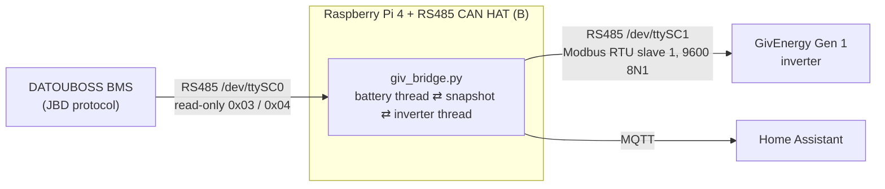

# GivEnergy Gen 1 ⇄ DATOUBOSS Battery Gateway


-orange)

**Run a GivEnergy Gen 1 hybrid inverter on a DATOUBOSS (JBD BMS) LiFePO4 battery.**

A Raspberry Pi 4 with a Waveshare RS485 CAN HAT (B) sits between the two. It reads the
battery's BMS on one RS485 port and answers the inverter's battery polls on the other, so
the inverter sees a GivEnergy-style battery carrying live data. The same readings go to
Home Assistant over MQTT.



It replaces an earlier ESP32 emulator
([Givenergy-Gen1-EM115-Emulator](https://github.com/dobberzzr/Givenergy-Gen1-EM115-Emulator),
now retired) and a separate Pi Zero MQTT bridge, and runs on the author's own system.

> ⚠️ **Safety.** The gateway is **not** pack protection; the BMS is. It only ever *reads*
> from the BMS and never writes to it. Values marked `ESTIMATE` in the config are not from
> a datasheet or a capture: check them before relying on them. Use at your own risk.

## Contents

- [Features](#features) · [Requirements](#requirements) · [Quick start](#quick-start)
- [How it works](#how-it-works) · [What the inverter is told](#what-the-inverter-is-told)
- [Home Assistant](#home-assistant) · [Configuration](#configuration)
- [Troubleshooting](#troubleshooting) · [Known Gen 1 behaviour](#known-gen-1-behaviour)
- [What stops discharge](#gen-1-settings-what-stops-discharge) · [When the BMS's SoC is wrong](#when-the-bmss-soc-is-wrong) · [Protection thresholds](#protection-thresholds)
- [Repository layout](#repository-layout) · [Licence](#licence)

## Features

- **Live data to the inverter**: voltage, current, SoC, capacity, all 16 cell voltages and
  temperatures, taken from the real BMS.
- **Inverter side never blocks.** It answers from a snapshot, so a slow or dead BMS, or
  MQTT being down, cannot stall a reply.
- **Staged fail-safe.** Stale data is never presented as live; the inverter is told to stop
  current flow after 5 s and "full + empty" after 20 s.
- **BMS protections respected.** Any JBD protection flag, a switched-off FET, or a
  pack/cell voltage or temperature limit is passed on as the matching alarm.
- **Home Assistant auto-discovery**: the battery as one device, plus what the inverter is
  currently being told and *why*.
- **Hardened service**: unprivileged user, sandboxed systemd unit, restarts itself.
- **Self-test** that needs no hardware (`--selftest`).

## Requirements

| | |
|---|---|
| Computer | Raspberry Pi 4 |
| HAT | Waveshare **RS485 CAN HAT (B)** (SC16IS752, two RS485 channels over SPI) |
| Battery | DATOUBOSS / JBD BMS with its RS485 port, **16 cells** (the code rejects any other count) |
| Inverter | GivEnergy Gen 1 hybrid, using its BMS RS485 port |
| Software | Python 3, `pyserial`, `paho-mqtt` 2.x, an MQTT broker (e.g. Home Assistant's Mosquitto) |

## Quick start

### 1. Wire it

| HAT device | Connect to |
|---|---|
| `/dev/ttySC0` | the battery's RS485 (A/B) |
| `/dev/ttySC1` | the inverter's BMS RS485 port (A/B) |

Check Waveshare's manual for which terminal block is which channel. If the battery turns
out to be on the other one, swap `battery_port` and `inverter_port` in the config.

### 2. Enable the HAT

Add to `/boot/firmware/config.txt`, then reboot:

```
enable_uart=1
dtparam=spi=on
dtoverlay=sc16is752-spi1,int_pin=24
```

`ls -l /dev/ttySC*` should now show two devices (group `dialout`).

### 3. Install

```bash
# dependencies, importable by /usr/bin/python3: pyserial and paho-mqtt 2.x
sudo apt install python3-serial python3-paho-mqtt
python3 -c "import paho.mqtt.client as m; m.CallbackAPIVersion"   # must not raise
#   if it does, your distro ships paho 1.x: use  pip install -r requirements.txt

# program files
sudo mkdir -p /opt/giv-bridge
sudo cp giv_bridge.py jbd_mqtt.py /opt/giv-bridge/

# service account and config (config is readable only by root and group giv)
sudo useradd --system --no-create-home --shell /usr/sbin/nologin giv
sudo install -m 640 -o root -g giv giv-bridge.conf.example /etc/giv-bridge.conf
sudo nano /etc/giv-bridge.conf        # set mqtt_host / mqtt_username / mqtt_password

# service
sudo cp giv-bridge.service /etc/systemd/system/
sudo systemctl daemon-reload
sudo systemctl enable --now giv-bridge
```

> If `jbd_mqtt.py` already runs somewhere else (for example on a Pi Zero), **stop it
> first**. Both publish to the same topics.

### 4. Check it

```bash
python3 giv_bridge.py --selftest      # no hardware needed; prints "selftest OK"
journalctl -u giv-bridge -f           # ports opened, "inverter told: ..." lines
python3 giv_bridge.py -v              # log every frame (stop the service first)
```

## How it works

Two threads that only share a snapshot:

- **Battery thread** polls the BMS about once a second (`gw_poll_interval`), updates the
  snapshot, and publishes to MQTT every 5 s (`gw_mqtt_interval`).
- **Inverter thread** answers the Gen 1's polls from the snapshot: FC03 (holding
  registers), FC04 (three input-register blocks) and FC06 (echoed unchanged). Replies go
  out 50 ms after the request. Devices 2 to 5 are answered as "no battery here".

Everything the inverter is told is worked out from the snapshot **and its age** at the
moment of the reply.

## What the inverter is told

| Register | Value |
|---|---|
| HR11 | the BMS's real capacity, Ah |
| HR20 | alarm bits (below) |
| HR21 | the BMS's own SoC, unscaled |
| HR22 | pack voltage, 0.01 V |
| HR23 | current, 0.01 A (+ = charging) |
| HR24 | temperature, whole °C |
| HR25 | current limit, 0.01 A |

FC04 blocks 1 to 3 carry the serial, temperatures, pack voltage, capacities, SoC and the
16 cell voltages with the highest and lowest cell.

**Fail-safe, by age of the last good BMS read:**

| BMS data age | What the inverter is told |
|---|---|
| under 5 s | live values, HR25 = `limit_a` |
| 5 s or more (stage 1) | HR25 = 0: stop current flow |
| 20 s or more (stage 2) | HR25 = 0 **and** HR20 bits 2 + 3 ("full" + "empty") |

**HR20 alarm bits:**

| Bit | Meaning | Raised by |
|---|---|---|
| 0 | over-current | BMS charge/discharge over-current |
| 1 | short circuit | BMS short-circuit flag |
| 2 | over-voltage ("full") | BMS cell/pack over-voltage, pack/cell over-voltage latch, charge FET off |
| 3 | under-voltage ("empty") | BMS cell/pack under-voltage, pack/cell under-voltage latch, discharge FET off |
| 4 / 5 | discharge / charge over-temperature | BMS flags |
| 6 | discharge under-temperature | BMS flag |
| 7 | charge under-temperature | BMS flag, or temperature latch (trips at 0 °C, clears at 5 °C) |

Any alarm bit, or any BMS protection flag, also drops HR25 to 0. Latches trip at one level
and clear at another, so they cannot chatter.

## Home Assistant

With MQTT discovery the battery appears as **one device**:

- **Battery**: pack voltage, current and power, SoC, remaining and design capacity, cycles,
  cell min/max/average/spread, lowest and highest cell number, all 16 cells, every
  temperature, charge/discharge FET, balancing, and each protection alarm.
- **Inverter side** (the part that tells you what the inverter is seeing):

| Entity | Meaning |
|---|---|
| Inverter current limit (HR25) | amps being offered to the inverter |
| SOC told to inverter (HR21) | % |
| Inverter alarm register (HR20) | the alarm bits |
| Fail-safe stage | 0, 1 or 2 |
| BMS data age | seconds since the last good BMS read |
| Since inverter last polled | seconds |
| Inverter replies sent | counter |
| Why the inverter is limited | plain text, e.g. `BMS data 12 s old`, `charge FET off` |
| Inverter polling | on if the inverter polled in the last 30 s |
| Inverter limited | on while HR25 is 0 |

Topics, under `topic_prefix` (default `jbd/datouboss`): `/state` (BMS), `/inverter`
(what the inverter is told), `/availability` (online/offline). Entities go unavailable
after `expire_after` seconds without data.

## Configuration

Copy `giv-bridge.conf.example` to `/etc/giv-bridge.conf`. The section is `[jbd-mqtt]`
(`giv_bridge.py` reuses `jbd_mqtt.py`'s loader). Use `-c FILE` or `GIV_BRIDGE_CONF` to
point at another file.

| Setting | Default | Notes |
|---|---|---|
| `mqtt_host`, `mqtt_port`, `mqtt_username`, `mqtt_password` | `localhost`, `1883` | your broker login |
| `topic_prefix`, `device_id`, `device_name` | `jbd/datouboss`, `datouboss_jbd`, … | keep the same as an old `jbd_mqtt` so Home Assistant sees one device |
| `expire_after` | `60` | seconds before entities go unavailable |
| `battery_port`, `inverter_port` | `/dev/ttySC0`, `/dev/ttySC1` | swap if wired the other way round |
| `baud` | `9600` | both ports |
| `gw_poll_interval`, `gw_mqtt_interval` | `1.0`, `5.0` | seconds |
| `limit_a` | `100` | HR25 while healthy, amps. `ESTIMATE`: the Gen 1 tops out near 50 A |
| `pack_ov_trip_v` / `_recover_v` | `56.8` / `55.2` | pack over-voltage latch, from the BMS screen |
| `pack_uv_trip_v` / `_recover_v` | `44.8` / `46.4` | pack under-voltage latch |
| `cell_ov_trip_v` / `_recover_v` | `3.55` / `3.45` | per-cell backstop ahead of the BMS. `ESTIMATE` |
| `cell_uv_trip_v` / `_recover_v` | `2.90` / `3.05` | per-cell backstop. `ESTIMATE` |
| `charge_ut_trip_c` / `_recover_c` | `0` / `5` | no charging below 0 °C, resumes at 5 °C |

## Troubleshooting

| Symptom | Likely cause |
|---|---|
| `bad BMS read … timeout` in the log | battery on the other port (swap `battery_port` / `inverter_port`), A/B swapped, or wrong baud |
| *Inverter polling* is off, or *Since inverter last polled* keeps growing | inverter not on `inverter_port`, A/B swapped, or inverter's BMS port not connected |
| *Inverter limited* is on | read *Why the inverter is limited*: stale BMS data, a protection flag, a FET off, or a voltage/temperature latch |
| `ImportError` / `CallbackAPIVersion` on start | `paho-mqtt` 1.x installed; use 2.x |
| Duplicate or flapping Home Assistant entities | `jbd_mqtt.py` still running somewhere else |
| Service up but no MQTT data | the inverter side keeps working by design; check broker address and login in the config |

## Known Gen 1 behaviour

If the inverter is told to stop at night (HR20 full/empty, or HR25 = 0) it can drop into
standby and stay there until restarted, because there is no solar to wake it. This was
seen with the earlier ESP32 emulator. It is why stage 2 waits a full 20 seconds, and why a
Home Assistant alert for "cheap rate on, battery idle at 0 W for 10 minutes" is a good
backstop.

A ready-made automation is in
[`homeassistant/charge_watchdog.yaml`](homeassistant/charge_watchdog.yaml). During cheap
rate, with the charge schedule on and SoC below 95 %, it alerts your phone when the
battery has idled at about 0 W for 10 minutes. Between 23:30 and 05:30 it also restarts
the inverter, then reports whether charging resumed. Replace the placeholders at the top
of the file with your own entity IDs before using it.

## Gen 1 settings: what stops discharge

On the author's Gen 1, Eco-mode discharge stops at the inverter's **battery cutoff
(HR114)**. The *reserve* (HR110) does not: with the reserve at 20 % and the SoC at 14 %
the battery kept discharging, and raising HR114 to 15 stopped it at once. This was
observed on one inverter, so check yours before relying on it.

The cutoff is compared with the SoC the **BMS reports**, so it is only as good as that
number.

## When the BMS's SoC is wrong

Seen once, on 26 Oct 2026: this pack's BMS stopped counting at 15 % (48.66 Ah) while
about 20 Ah left the pack. The SoC sat frozen at 15 % for over an hour. It counted again
after a charge, but stayed about 6 points too high, because the gateway passes the BMS's
SoC straight through and the inverter's cutoff then acted at a lower real level than set.

To check, compare `remaining` Ah with the Ah that actually flowed (add up the pack
current over a few minutes): they should agree. Whether a full charge re-syncs the BMS
has not been confirmed yet. Cell voltages are a weak guide on LFP, because the curve is
flat for most of the range.

## Protection thresholds

BMS limits as listed for the DATOUBOSS pack this was built for, next to what the gateway
does. The gateway acts ahead of the BMS on pack voltage, so the inverter is told "full" or
"empty" before the BMS would cut the battery off. Whenever any HR20 bit is set, HR25 is
also dropped to 0.

| Protection | BMS trip / recover | Gateway | HR20 bit |
|---|---|---|---|
| Pack over-voltage | 58.4 V / 54.0 V | latch 56.8 V / 55.2 V (acts first), plus the BMS flag | 2 |
| Pack under-voltage | 43.2 V / 46.4 V | latch 44.8 V / 46.4 V (acts first), plus the BMS flag | 3 |
| Cell over / under-voltage | BMS flags | latches 3.55 V / 3.45 V and 2.90 V / 3.05 V (`ESTIMATE`) | 2 / 3 |
| Charge high temperature | 55 °C / 50 °C | BMS flag only | 5 |
| Charge low temperature | 0 °C / 5 °C | latch on the coolest sensor, same point as the BMS, plus the BMS flag | 7 |
| Discharge high temperature | 55 °C / 50 °C | BMS flag only | 4 |
| Discharge low temperature | -20 °C / -15 °C | BMS flag only | 6 |
| Over-current, charge and discharge | 215 A | BMS flag only | 0 |
| Short circuit | BMS flag | BMS flag only | 1 |
| Charge / discharge FET switched off | n/a | treated as full / empty | 2 / 3 |

Code comments mention "157 A continuous": that is the pack's rating, and 215 A is the
BMS's over-current trip. The Gen 1 itself tops out near 50 A.

## Repository layout

| File | What it is |
|---|---|
| `giv_bridge.py` | the gateway: battery thread, inverter thread, MQTT, self-test |
| `jbd_mqtt.py` | JBD protocol and MQTT/Home Assistant code, imported by the gateway; also runs alone as a read-only battery-to-MQTT bridge |
| `giv-bridge.service` | systemd unit (user `giv`, sandboxed) |
| `giv-bridge.conf.example` | config template |
| `requirements.txt` | `pyserial`, `paho-mqtt` 2.x |
| `homeassistant/charge_watchdog.yaml` | optional Home Assistant automation: alert (and overnight inverter restart) when the battery stops charging during cheap rate |

## Licence

MIT. See [`LICENSE`](LICENSE).
